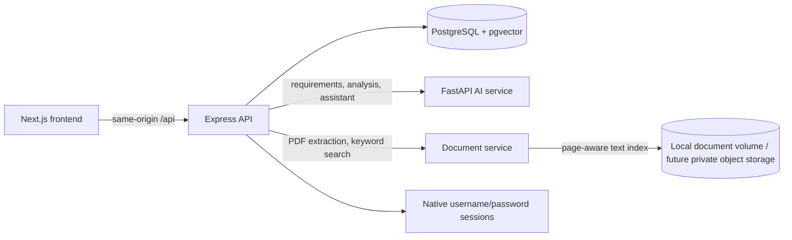

# Architecture

AssignmentOS is organized as a browser-facing Next.js app, a request-owning Express API, and separate FastAPI services for AI and document processing.

## Ownership boundaries

- `frontend/` owns routes, UI components, browser state, and API client behavior. It never stores provider secrets.
- `backend/` owns validation, request authentication, resource ownership checks, assignment CRUD, draft persistence, and calls to the Python services.
- `ai-service/` owns deterministic brief parsing and analysis plus optional model-backed coaching and passage-grounded responses.
- `document-service/` owns file validation, page-aware PDF extraction, text chunking, and keyword search. Semantic search/OCR are extension points only.
- `database/` owns ordered PostgreSQL schema migrations and seed data.

The frontend rewrites `/api/*` to the Express service. In Docker, Next uses `API_INTERNAL_URL=http://backend:4000`; local frontend development can proxy to `http://127.0.0.1:4000`.

## Authentication and trust

The API stores unique student usernames and bcrypt password hashes in PostgreSQL and issues signed, expiring HttpOnly session cookies. Supabase SSO remains an optional integration. Without a session, non-production API requests use `DEV_USER_ID` to simplify service development; production mode rejects unauthenticated requests. Never use the development user fallback on a public deployment.

All user input and uploaded file metadata are validated at the API/service boundary. The document service currently persists extracted page text/chunks in a local Docker volume, not the original PDF. Add private object storage and signed URLs before production. Automated requirement matches are suggestions, not grades. AI prompts treat briefs and drafts as untrusted content.

## Local deployment

`docker compose up --build` runs PostgreSQL 16 with pgvector, backend migrations/seeding, AI service, document service, and the frontend. The standalone services can also be run individually; see `docs/development.md`.
